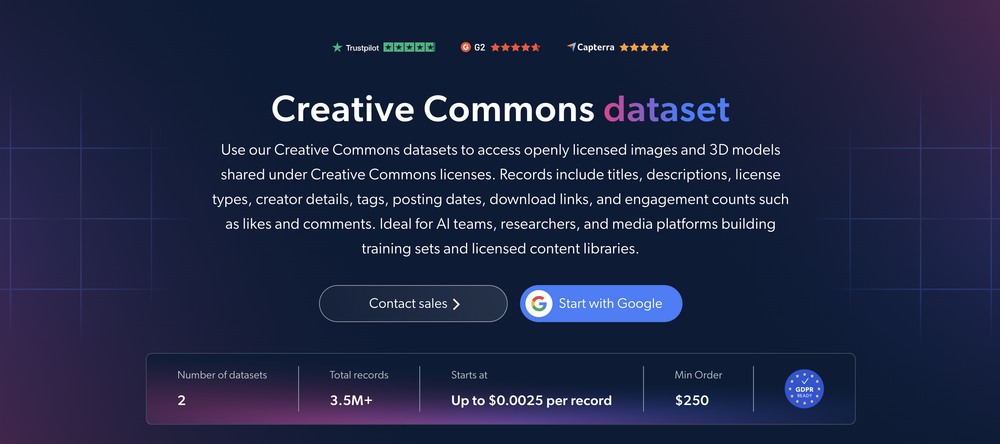

# Creative-Commons-dataset-samples

<h2>A sample dataset of 1000 Creative Commons 3D models</h2>

<a href="https://brightdata.com/products/datasets/creative-commons">
   
</a>

A Creative Commons dataset sample of 1000 openly licensed 3D models. Dataset was extracted using the <b>Bright Data API</b>.

<h2>Some of the data points that are included in the dataset:</h2>

* ```url```: URL of the 3D model page
* ```id```: Unique identifier for each 3D model
* ```domain```: Source domain of the 3D model
* ```title```: Title of the 3D model
* ```description```: Description of the 3D model
* ```license```: Creative Commons license type of the 3D model
* ```images```: Preview images of the 3D model
* ```creator_details```: Details about the creator of the 3D model
* ```tags```: Tags associated with the 3D model
* ```date_posted```: Date the 3D model was posted
* ```download_url```: Download URL of the 3D model files
* ```num_files```: Number of files included with the 3D model
* ```num_likes```: Number of likes on the 3D model
* ```num_comments```: Number of comments on the 3D model
* ```print_settings```: Recommended 3D printing settings

This is a sample subset which is derived from the "Creative Commons 3D Models (public data)"
dataset which includes more than <b>24,000 3D models</b>.

Available dataset file formats: <b>JSON, NDJSON, JSON Lines, CSV, XLSX, or Parquet. Optionally, files can be compressed to .gz</b>.

Dataset delivery type options: <b>Email, API download, Webhook, Amazon S3, Google Cloud storage, Google Cloud PubSub, Microsoft Azure, Snowflake, SFTP</b>.

Update frequency: <b>Once, Daily, Weekly, Monthly, Quarterly, Biannual, or Custom basis</b>.

Data enrichment available as an addition to the data points extracted: <b>Based on request.</b>

<b>[Get the full Creative Commons dataset](https://brightdata.com/products/datasets/creative-commons)</b>.

<a href="https://brightdata.com/products/datasets/creative-commons">
</a>

<h2>What are the Creative Commons datasets use cases?</h2>

<h3>1. AI training data</h3>
AI teams use Creative Commons datasets to build 3D training sets from openly licensed models. Filtering by license type and tags, with direct download links and preview images, keeps usage terms clear and makes it easy to assemble data for 3D generation, computer vision and multimodal models.

<h3>2. License compliance</h3>
Companies check the license and creator behind each 3D model to attribute correctly and reuse only what each license allows. This reduces legal risk when using open 3D content in products, games, research or 3D printing projects.

<h3>3. Content trends and creator discovery</h3>
Platforms and brands track which subjects and styles are posted and liked over time using tags, posting dates, likes and comments. This reveals rising themes in open 3D content and highlights the most engaging creators for partnerships, commissions or community programs.

<h2>Free access to web scraping tools and datasets for academic researchers and NGOs</h2>

The Bright Initiative offers access to Bright Data's <b>[Web Scraper APIs](https://brightdata.com/products/web-scraper)</b> and <b>[ready-to-use datasets](https://brightdata.com/products/datasets)</b> to leading academic faculties and researchers, NGOs and NPOs promoting various environmental and social causes. You can submit an application <b>[here](https://brightinitiative.com)</b>.
